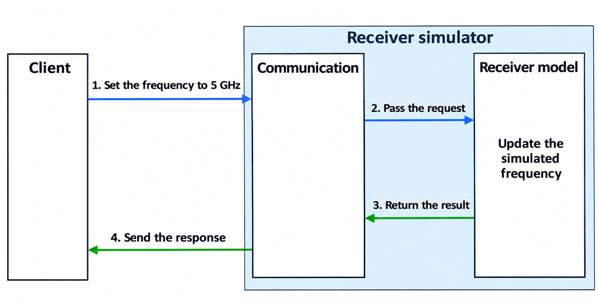

# Implement and verify hardware communication

Once the [hardware contract](hardware_contract.md) is agreed, the agent implements
the simulator. This guide uses a fictitious receiver as a working example to show
how a simulator works and how it is organized.

## Start and stop the simulator

Simquaro is a tool included in Synqaro for simulating hardware on your computer.
To start the fictitious receiver simulator, open a terminal and run:

```sh
simquaro start receiver-a
```

To stop it, press **Ctrl+C** in the same terminal.

Later in this guide, you will learn how to interact with the receiver simulator.

## How the simulator is organized

This explanation helps you understand how the simulator works. You do not need
to develop it yourself: the agent will follow the same structure when implementing
a simulator for your hardware.

Simquaro provides:

- **Communication code** that receives requests and sends responses according to
  the [proposed communication protocol](hardware_protocol.md).
- **A receiver model** that reproduces the receiver’s behavior and stores its
  simulated state, such as the current frequency.
- **Management tools** for starting and stopping simulator instances and
  introducing faults for testing.

The following diagram shows what happens when a client—a program communicating
with the simulator—asks to change the frequency.



The management tools are not shown because they do not participate in this
request and response.

## What we will verify

Once the agent has implemented the simulator, we need to check that it behaves as
specified in the hardware contract. Before trying it, let’s look at what our
fictitious receiver can do.

A receiver can be tuned to a frequency, much like a radio. In this example, we can:

- **Set and read the frequency.** Choose a value between 1 and 10 GHz, then ask
  the receiver which frequency is currently set.
- **Read its status.** Check whether it reports a fault, whether an operation is
  running, and whether it is calibrated.
- **Run a calibration.** Calibration normally adjusts a receiver using a known
  reference. Our simulator reproduces this procedure without physical measurements.
  It takes about ten seconds and, if successful, marks the receiver as calibrated.
  During calibration, the operating frequency cannot be read or changed.
  Successful calibration restores the frequency that was set before it started.
- **Request cancellation.** Ask the receiver to stop an ongoing calibration,
  when cancellation is allowed.

Changing the operating frequency invalidates the previous calibration.

## Try the receiver from the command line

The command-line interface (CLI) lets you type requests and inspect the receiver’s
responses. These manual checks are optional because automated tests provide more
comprehensive, targeted checks of the specified scenarios. Manual checks help you
explore the behavior or investigate a problem.

### Start the simulator

Open a terminal and run:

```sh
simquaro start receiver-a
```

This starts the fictitious receiver named `receiver-a`. It is now running and
waiting for requests. Keep this terminal open.

### Open a console

In a second terminal, run:

```sh
simquaro console receiver-a
```

The console connects to the running simulator. It lets you write a request,
sends it to the simulator, and displays the response.

**Starting the simulator and opening a console are different operations.**
The console does not start the receiver, and closing the console does not stop it.

You can open a console in the same way for any configured target implementing the
[default communication protocol](hardware_protocol.md). The request syntax is
shared; the available properties and operations depend on the hardware.

The name selects the simulator you want to use. If another simulator were
configured with the name `pippo`, you would start it with:

```sh
simquaro start pippo
```

And open its console with:

```sh
simquaro console pippo
```

### Set and read the frequency

In the receiver console, enter this request and press **Enter**:

```text
#set <id=1>: name=frequency, value=5.5, unit=GHz
```

Response:

```text
#ok <id=1>: name=frequency, value=5.5, unit=GHz
```

`ok` confirms that the simulator has applied the setting.

Each request in the [default protocol](hardware_protocol.md) has an `id`.
Use a higher number for every new request on the same connection. The response
repeats that number so you can match it to the request. The console adds the
newline required by the protocol when you press **Enter**.

Now read the frequency:

```text
#get <id=2>: name=frequency
```

Example response:

```text
#ok <id=2>: name=frequency, value=5.5, unit=GHz, sampled_at=2026-11-16T10:00:00Z
```

`sampled_at` tells you when the value was read.

### Start a calibration and check its result

Calibration takes about ten seconds. The receiver replies promptly to confirm
acceptance; it does not wait for calibration to finish before replying. You will
then ask for its status to find out whether it has completed.

Enter the following request and wait for the acceptance response:

```text
#run <id=3>: name=calibrate
```

Response:

```text
#accepted <id=3>
```

`accepted` means that calibration has been accepted for execution, not that it
has finished.

Ask how it is progressing:

```text
#status <id=4>: name=calibrate
```

While calibration is running, the response reports `state=running`. After about
ten seconds, ask again using a new ID:

```text
#status <id=5>: name=calibrate
```

A successful calibration reports `state=succeeded`. The response also includes
its start and finish times when available.

### Send requests from a script

The console is useful when you want to choose and type each request yourself.
A script is useful when you want to repeat a prepared sequence without typing
the requests again.

The script connects directly to the running simulator. It does **not** send
requests through the console.

Keep the simulator running in the first terminal. You can close the console with
**Ctrl+C** and use that second terminal to run the script.

The following example is a Python script that explains each operation and waits
for you to press **Enter** before sending the request. It then displays the
response received from the simulator.

<details>
<summary>Show the Python example</summary>

Save this code as `try_receiver.py`:

```python
import socket


def exchange(connection, reader, *, explanation, request, expected_reply):
    input(f"\n{explanation}\nPress Enter to send the request.")
    print(f"Request:  {request}")

    connection.sendall((request + "\n").encode("ascii"))
    response = reader.readline(4097)

    if not response:
        raise ConnectionError("The receiver closed the connection.")
    if len(response) > 4096 or not response.endswith(b"\n"):
        raise ValueError("The receiver returned an invalid message.")

    text = response.decode("ascii").rstrip("\n")
    print(f"Response: {text}")

    if text != expected_reply and not text.startswith(expected_reply + ":"):
        raise RuntimeError(f"Unexpected response: {text}")


# Default address of receiver-a.
with socket.create_connection(("127.0.0.1", 9001), timeout=2) as connection:
    with connection.makefile("rb") as reader:
        exchange(
            connection,
            reader,
            explanation="Set the receiver frequency to 5.5 GHz.",
            request="#set <id=1>: name=frequency, value=5.5, unit=GHz",
            expected_reply="#ok <id=1>",
        )

        exchange(
            connection,
            reader,
            explanation="Read the frequency currently set.",
            request="#get <id=2>: name=frequency",
            expected_reply="#ok <id=2>",
        )

        exchange(
            connection,
            reader,
            explanation="Start calibration. Acceptance does not mean completion.",
            request="#run <id=3>: name=calibrate",
            expected_reply="#accepted <id=3>",
        )

        exchange(
            connection,
            reader,
            explanation="Check the calibration state.",
            request="#status <id=4>: name=calibrate",
            expected_reply="#ok <id=4>",
        )

        exchange(
            connection,
            reader,
            explanation="Check again. Calibration normally takes about ten seconds.",
            request="#status <id=5>: name=calibrate",
            expected_reply="#ok <id=5>",
        )
```

`request` is the message sent to the simulator. `expected_reply` identifies the
expected response type and request ID; it is used to check the actual response
and is never sent.

From the folder where you saved the file, run:

```sh
python3 try_receiver.py
```

The script sends one request at a time and waits for its response before offering
the next step. It stops if communication fails or the receiver returns an
unexpected response. It does not retry commands automatically.

The last response tells you the calibration’s current state. It may still be
running if you proceed quickly. Finishing the script does not itself prove that
calibration succeeded.

This is a guided communication example, not an automated verification test.

</details>

You can ask the agent to write a script for the sequence you want to try.
For example:

> Set the receiver frequency to 5.5 GHz, read it back, start calibration, and check
> its status until it finishes.

### How the console and script communicate

Both the console and the Python script connect to the **Communication** component
shown in the earlier diagram. Each uses its own TCP connection.


Communication receives requests, passes them to the receiver model, and sends
each response back to the connection that made the request. The messages follow
the [default communication protocol](hardware_protocol.md).

The receiver model is shared. If the script changes the frequency, a subsequent
read from the console sees the new value.

To stop the simulator, press **Ctrl+C** in the terminal where you started it.

## First use: the browser GUI

```sh
simquaro gui
```

Keep the terminal open. It prints `http://127.0.0.1:8765` and opens your browser
after HTTP startup succeeds. If opening fails, copy the URL manually. For a busy
port use `simquaro gui --port 8766`; `--no-browser` suppresses opening.
Launching the GUI does not start a simulator automatically.

1. Select **receiver-a**, click **Start simulator**, and wait for `start: succeeded`.
   This confirms the local process, not physical-hardware health.
2. In **Console**, keep **Guided** mode and click **Connect**. This explicitly
   reads hardware configuration/status. Each tab has its own TCP connection;
   a second tab can select another target independently.
3. In **Control**, enter a frequency and click **Set frequency** / **Read frequency**.
   Inspect the parsed response and actual TX/RX bytes. The receiver applies
   `5.1234565` GHz as `5.123457` GHz; input spelling reaches firmware unchanged.
4. Click **Run calibrate**, then **Read procedure status**. Explicitly enable
   **Monitor procedure** for status requests every 500 ms; it is off by default.
   Open **Scan settings** for a ten-point scan; choose **Procedure → scan** to
   inspect/cancel it. This console does not associate scientific data with scan points.
5. Select **Raw** in **Console mode** (disconnecting the old connection), click
   **Connect**, enter `#nonsense <id=77>\n`, then **Send literal request**.
   Expect `code=UNKNOWN_VERB`. Raw escapes are `\n`, `\r`, `\t`, `\xNN`, and `\\`;
   no LF/ID/probe/retry is added. **Literal line** instead appends LF. A two-second
   no-data notice leaves TCP open. Invalid protocol messages are allowed.
6. Open **Simulator fault injection**, click **Refresh faults**, select
   `frequency_read_failure`, then **Activate fault**. Guided frequency reads now
   report an error. **Clear fault** removes the cause. Scheduling uses explicit
   trigger events and occurrence counts; reads/monitoring may consume matching rules.
7. Click **Disconnect** before **Tests → Run checks**. Read-only is the default.
   Modifying checks require the checkbox and confirmation for each run. Close
   other GUI connections to that target and isolate external clients yourself.

The four sections share one page, with navigation links. Selecting a target or
polling event/job displays sends no hardware TCP requests. Physical-hardware
targets have no simulator process or fault controls.

### Save and apply startup configuration

**Configuration** shows its path and distinguishes editor draft, saved settings,
and trusted active startup settings. Initially the example is **Built-in defaults
— not saved**. The first explicit Save creates the file; Save alone never restarts
an instance. **Apply saved settings** explicitly restarts only this simulator,
losing current state/fault schedules. A failed apply leaves saved values saved:
inspect whether the process is stopped/running/unknown; no rollback is claimed.
A stale editor cannot overwrite another tab's save: reload first.

New connections/check jobs use saved endpoint/identity settings. Existing sessions
retain their original snapshot until explicit reconnect. If saved and active
settings differ, Apply before connecting to a changed endpoint. Active startup
frequency is not the live frequency after operational commands.

Default file: `$XDG_CONFIG_HOME/simquaro/instances.json` when that variable is an
absolute path, otherwise `~/.config/simquaro/instances.json`. To select another:

```sh
simquaro --config /absolute/path/instances.json config init
simquaro --config /absolute/path/instances.json gui
```

Use the same global `--config` for related CLI commands. GUI editing covers
existing targets only. Add instances of registered models in version-1 JSON,
run `config validate`, and Reload inventory; see the [operator guide](simquaro.md)
before identity/model/kind changes.

## Advanced console use

Use raw mode for bytes or deliberately incomplete requests:

```sh
simquaro console receiver-a --raw
```

Here type `#status <id=1>\n`: the two characters `\n` represent one LF byte.
Enter does not append another LF. `text\x00\xFF\n` includes arbitrary bytes.
Invalid escape notation is rejected locally; invalid protocol messages are sent.
Missing replies, malformed replies, and closure are shown honestly; no fake error
response is invented. For exact framing/timeout rules see the operator guide.

## Run readable checks

Close the console, then run:

```sh
simquaro test receiver-a
```

This performs five read-only checks and clearly skips five checks requiring
changes. The report distinguishes passed, failed, and not executed. The default
run does not calibrate, change frequency, cancel an action, or reboot.

Only for an isolated target where changing state is authorized:

```sh
simquaro test receiver-a --allow-changes
```

This also tests rounding, calibration, scan, cancellation, and reboot. It leaves
state changed and does not restore earlier calibration/history. A failed or
uncertain test prevents later modifying checks. Neither reads nor `accepted`
responses prove the physical output of real hardware is correct.

## Stop

```sh
simquaro stop receiver-a
```

Alternatively Ctrl+C in the terminal that started the simulator cleans its owned
processes. Ctrl+C in the GUI server terminal closes sessions and stops only
simulator children created by that server, leaving preexisting instances alone.
Closing a browser tab does not stop the server/simulator. Unused TCP sessions
expire after 120 seconds; closing TCP never automatically cancels firmware work.
If stop needs escalation it handles that internally; no `--force` is needed.
After a crash use normal start/status/stop/restart, not manual socket/lock deletion.

## Troubleshooting

- Connection refused: start the selected simulator, check its printed endpoint,
  and retry console/test. These commands never start a simulator implicitly.
- Already running: use it, or run `simquaro restart receiver-a` if you
  explicitly need a restart. Process status and hardware-protocol health differ.
- No response: inspect the console's byte evidence and the framing rules; a
  timeout does not prove a modifying command was not executed. Do not blindly
  repeat it.
- For injected faults, detailed diagnostics, and JSON output, read the
  [operator guide](simquaro.md).
- Missing GUI packages: rerun `bash install.sh` from the downloaded project
  folder, as described in [Installation](../README.md#installation).
- Expired session: explicitly reconnect; the UI never resends a lost command.
- Lost HTTP response during a change: inspect **Recent jobs** and explicitly query
  hardware state; do not repeat blindly. Recent jobs are not a permanent log.
- Invalid/missing explicit configuration: correct the printed path/file and run
  `config validate` / `config init`; existing invalid files never fall back to defaults.

Persistent startup settings can now be inspected with
`simquaro config show` and explicitly initialized with
`simquaro config init`. Saving settings alone does not change a running
instance; `simquaro config apply receiver-a` applies them through a
foreground restart. See the operator guide before editing/applying configuration.

## Scope and developer verification

This is a trusted single-user workbench bound only to `127.0.0.1`, not an
authenticated remote service. Configuration persists, but historical software/
configuration snapshots and a permanent audit store are not implemented. Keep
configuration under your own change control when historical reconstruction matters.
Bulk scientific transfer and exact scan-frequency/data association remain open
protocol topics. Simulator tests do not establish physical-hardware correctness.

The following commands are for contributors working on source code. From the
repository directory, create a separate development environment with a supported
Python 3.12+ interpreter and run the base and web/browser suites:

```sh
python3 -m venv .venv
.venv/bin/python -m pip install -e '.[web,browser-test]'
PYTHONPATH=src .venv/bin/python -m unittest discover -s tests -t . -v
PYTHONPATH=src .venv/bin/python -m unittest discover -s tests/web -v
```

Browser tests use installed Google Chrome with isolated temporary contexts and
normal Chromium sandbox. Playwright is developer tooling, not needed for manual
GUI use. Tested versions/results are recorded in the operator guide.
