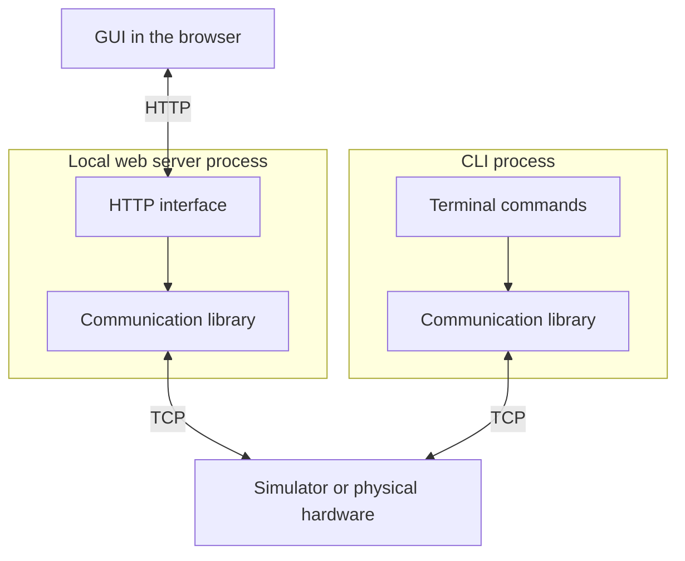

# Simquaro operator guide

Simquaro runs a deterministic fictitious receiver for protocol and failure tests.
It is independent of the Synqaro Device runtime. The initial configured instance
is `receiver-a`, listening at `127.0.0.1:9001`, with a verified frequency of 5 GHz,
invalid calibration, fresh firmware boot identity, unknown prior procedure history,
and no injected faults. Its hardware commands follow the
[Hardware Protocol](hardware_protocol.md).

## Install and run

Use Linux with `/proc`, pidfds, a supported local filesystem, and Python 3.12 or
newer. Python 3.12.3 (base) and 3.12.12 (web) are tested; Python 3.13-specific transport
cleanup has been checked in source, not executed in that interpreter.
The base CLI/library has no third-party runtime dependencies. The GUI uses the
optional `web` extra (FastAPI/Uvicorn). Setuptools is ordinary build tooling.

From the repository root, create an isolated environment and install:

```sh
python3 -m venv .venv
.venv/bin/python -m pip install '.[web]'
.venv/bin/simquaro --help
```

If the host lacks venv/ensurepip, install its Python venv support through your
normal environment provisioning. Build tooling may need an approved package
download. Do not install into the system interpreter. For development, use
`.venv/bin/python -m pip install -e '.[web]'` so source changes apply to the
next command. A normal installation copies the package; after source edits,
reinstall it into the same environment before restarting an instance.

Source execution needs no install or pip:

```sh
PYTHONPATH=src python3 -m simquaro --help
PYTHONPATH=src python3 -m simquaro list
```

`python -m simquaro` and the installed `simquaro` executable use the same entry
point. Examples below assume the environment's `bin` directory is on `PATH`.
Use the same environment and user in both terminals.

## Architecture and manual interfaces

The CLI starts/stops simulators, controls
injected faults, and provides the manual console below. The shared production
client is available under `synqaro_protocol`; tests construct that same client.
The GUI and CLI use the same persistent configuration and shared services.
For first hands-on use follow [Getting started](getting_started.md).

A simulator stands in for the physical apparatus and its firmware. A Synqaro
Device is a separate control process that communicates with that apparatus or
simulator. Starting a simulator does not start a Device.

The manual command paths are:



The two library boxes mean the same reusable Python code running in separate
processes, not two implementations or a single shared connection. The library
constructs protocol messages, communicates over TCP, correlates replies, and
reports errors. The CLI calls its functions directly. The browser sends HTTP
requests to a local server, which calls those same functions and returns the
results. A browser page cannot directly open an ordinary raw TCP connection.

For example, setting a frequency from the terminal calls the library directly.
Setting it from the GUI first reaches the local server over HTTP; the server
then makes the same library call. Replies and communication failures return
along the corresponding path. The GUI does not execute CLI commands in the
background, and neither path bypasses TCP by calling simulator model methods.
The interfaces should expose the actual transmitted requests, received replies,
and communication diagnostics, not just an interpreted success message.

The HTTP interface and the library's Python interface are different interfaces.
The GUI is a required deliverable and the primary entry point for a human user
to explore the simulator, not an optional future enhancement. Its installation,
startup, and use must be documented and verified; a CLI-only delivery does not
complete this follow-up work.

Only GUI use requires the local web server to be running. Terminal commands,
Python scripts, and automated tests remain usable without that server. Routing
the CLI through HTTP is deliberately not the current direction. CLI and GUI can
therefore be separate hardware clients and must obey the target's connection and
concurrency limits.

Simulator administration remains a separate path, not extra hardware commands:

| Change | Application path |
|---|---|
| Operational property, such as frequency | Hardware protocol over TCP; no simulator restart |
| Injected fault | Separate simulator test-control interface |
| Startup settings, such as port or initial frequency | Save validated configuration and restart only the affected simulator |

Fault injection and simulator startup editing are simulator-only functions, not
features of physical hardware. The GUI should offer only supported settings and
distinguish saved configuration from the configuration currently in use. The
configuration uses the versioned JSON file described below. Save and Apply are
separate operations; general hot reload is not available.

### Local browser server

`simquaro gui [--port 8765] [--no-browser]` runs foreground on `127.0.0.1` only,
one worker, no reload/proxy trust/CORS. It prints its URL after HTTP startup,
then attempts to open the browser; it starts no simulators implicitly. Busy ports
produce a corrective command and never cause another listener to be killed.
The page has Control, Console, Tests and Configuration sections. No CLI subprocess
is used: protocol operations use the production client or shared raw TCP transport.

Each tab owns its own session. Guided mode uses normal client bootstrap/recovery;
line/raw mode sends no probes, IDs, hidden polling or retries. Changing target/mode
disconnects first. Explicit monitoring sends procedure status every 500 ms; normal
event/job polling reads only server memory. Administration/fault refresh queries
local simulator control, not hardware TCP.

Limits: 16 sessions total/four per target, 120-second lease and 10-second browser
heartbeat, 256 events/1 MiB per session with cursor-gap markers; 16 active jobs,
64 retained completed reports, 1 MiB per report. No unbounded queue or permanent
job log. Checks use a dedicated client, require other GUI connections closed and
need per-run authorization to mutate. External-client isolation is up to the user.
Physical targets reject simulator administration server-side as well as hiding it.

Closing a tab leaves the server/simulator running. Ctrl+C closes sessions and
stops only server-created children with verified ownership; preexisting instances
remain running. After a server crash use normal `status`, `stop` or `restart`,
not manual socket/lock deletion. TCP closure never implicitly cancels firmware work.

The `/api` interface uses version-1 JSON envelopes, strict bounded bodies and
tagged protocol numbers such as `{"number":"5.1234565"}`. State-changing requests
require JSON content type and `X-Simquaro-Client: 1`. Exact Host/Origin checks,
cross-site rejection and self-only CSP guard the browser boundary, not malicious
local users/processes. Remote/multi-user serving needs a separate security design.
Firmware text is displayed as text, never HTML.

Persistent startup settings are not yet the historical software/configuration
snapshot and audit store envisaged for the future control system.

### Verified environment

The 2026-11-04 pre-review acceptance ran on Linux Mint 22.1 (Ubuntu noble base):
Python 3.12.3 for 293 base tests; Python 3.12.12 for 11 required web tests
(five API, five real Chrome browser workflows, one foreground launch). All passed.
Chrome 156.0.8078.79 used an isolated context with the Chromium sandbox enabled.
Resolved web/test versions: FastAPI 0.162.0, Uvicorn 0.54.0, HTTPX 0.28.1,
Playwright 1.64.1. Node, a frontend build, and browser downloads were not required
in this environment. Other OS/browser versions and real physical hardware have
not been verified. See the [delivery verification record](superpowers/verification/2026-11-04-simquaro-workbench.md)
for packaging evidence, engineering rulings and final-review results.

### Shared validation workflow

`simquaro test receiver-a` runs five read-only checks through the shared
production client, reporting five state-changing checks as not executed.
`simquaro test receiver-a --allow-changes` also tests frequency rounding,
calibration, scan, scan cancellation, and reboot (last). Run modifying checks
only against an isolated, explicitly authorized target: they leave state changed.
The command connects directly to the configured endpoint without requiring local
simulator administration. The same cases can target matching physical firmware;
that does not mean they have already been verified on physical hardware.

Results distinguish passed, failed, and skipped cases, identity/firmware/boot
evidence, and uncertain outcomes. Permission skips are expected in read-only
mode; other incomplete checks or any failure make exit status 1. Usage errors
exit 2. A failed/uncertain check blocks further mutations; no reset, retry of a
mutation, or blind state restoration is attempted. Global `--json` emits case
events and a final structured report. Internals/fault tests remain simulator-only.

A few direct TCP checks remain independent of that library. They check literal
protocol messages and deliberately invalid requests that the library normally
prevents. They do not repeat the complete functional suite. Internal simulator
tests and injected-fault scenarios also remain useful, but do not validate a
physical apparatus by themselves.

Automatic tests execute predefined scenarios and should produce readable results;
manual CLI and GUI use let an operator explore commands and inspect exchanges.
Neither replaces the other. A physical-hardware test that changes settings,
starts procedures, or reboots must run only in an explicitly authorized context.
Correct protocol replies do not prove the physical output is correct: verifying
the actual frequency, for example, may require an independent measurement.

## Manual TCP console

Start the simulator in one terminal, then in another run:

```sh
simquaro console receiver-a
```

Enter a complete ASCII message such as `#status <id=1>` and press Enter. Normal
mode appends LF; it does not validate syntax, insert IDs, or send startup probes.
Replies display escaped bytes, so terminal-control characters cannot execute.
Each console opens its own persistent TCP connection. The selected inventory's
endpoint can also refer to physical hardware; no local simulator is required.

For partial requests or arbitrary bytes, use:

```sh
simquaro console receiver-a --raw
```

Here Enter submits exactly the represented bytes without appending LF. Enter
`#status <id=1>\n` for a complete request, or `#status <id=1>` deliberately
without its terminator. Supported escapes are `\n`, `\r`, `\t`, `\xNN`, and `\\`.
For example `text\x00\xFF\n` sends a NUL and byte FF among ordinary ASCII.
Invalid escape notation sends nothing; invalid hardware-protocol input is allowed.

A no-data notice after two seconds is a local observation, not a firmware error,
and does not close the connection or send probes. Firmware may close for oversized
or incomplete messages. Reopen with the displayed command; nothing is replayed.
Ctrl+C closes the console; it does not cancel an executing hardware procedure.
EOF on piped stdin half-closes transmission and observes replies for up to two
seconds. `simquaro --json console receiver-a --raw` emits version-1 JSON Lines.
Diagnostic submissions are locally capped at 64 KiB, independently of firmware's
4096-byte message limit, so oversized-message testing remains possible.

## Inventory and startup configuration

The operator inventory is version-1 JSON. By default it is stored in
`$XDG_CONFIG_HOME/simquaro/instances.json` when XDG_CONFIG_HOME is absolute,
otherwise `~/.config/simquaro/instances.json`. Global `--config PATH` selects
another file. Inspect its actual path and values with:

```sh
simquaro config show
simquaro config init
simquaro config validate
simquaro --config /absolute/path/instances.json config show receiver-a
```

A missing implicit file uses labeled built-in defaults without writing anything.
`config init` explicitly saves them and never overwrites an existing file. A
missing explicit path or existing invalid file is an error, never a fallback.
JSON contains `version: 1` and an `instances` array; records use name/model,
host/port, `kind` (`simulator` or `hardware`), and the registered model's settings
key (`receiver` for this example). Missing settings use validated model defaults.
Hardware targets require an explicit expected hardware_id and cannot receive
simulator lifecycle/fault/apply actions. `start all` skips them visibly.

Save does not alter a running simulator. Apply saved settings explicitly:

```sh
simquaro config apply receiver-a
```

This follows start/restart's foreground policy and restarts only this simulator.
It may interrupt procedures/connections and discard runtime fault schedules.
Failure does not silently restore the old configuration: inspect the reported
active/stopped/unknown state, correct the saved values, and retry deliberately.
Existing connections stay pinned after a save; new console/check connections
use saved endpoint/identity settings, which may not yet be serving until Apply.

Atomic saves use a revision to reject stale edits from another tab and reuse
crash-left lock files automatically; never remove locks manually. File size is
capped at 1 MiB; unknown/duplicate fields, nonfinite numbers, unsafe paths and
invalid model values are rejected. Startup frequency is not silently rounded.
[`InstanceConfig`](../src/simquaro/config.py) and model-specific validated types
remain available for programmatic construction. The explicit model registry,
not this JSON file, defines available implementations.

Names are flat: `[a-z][a-z0-9_-]{0,47}`. `all` is reserved. Each inventory entry
needs a unique host/port and a fixed port from 1 through 65535. Adding another
instance reuses the implemented `fictitious_receiver` model with independent
state. Changing a firmware label does not implement new firmware behavior.
`all` selects exactly this validated inventory, never every installed module.

Configuration describes startup. Current frequency, physical state, procedure
results, active faults, and remaining rule counters are separate live state.
Changing startup configuration requires restarting only the affected instance;
connections and operations on that instance can be interrupted. Endpoint changes
also require matching client configuration. An already running instance is
inspected, never silently reconfigured. `status` JSON includes both `configured`
(current loader values) and `startup_config` (the running process's values).
There is no external file loader or general hot reload in this version.

The internal Python spelling is now `settings=ReceiverConfig(...)`, not
`receiver=ReceiverConfig(...)`. Receiver CLI JSON and runtime records still use
the original `receiver` key; this refactor does not change their record format.

Programmatic tests can construct configurations and typed
`Scenario(initial_faults=(FaultEffect(...),), rules=(FaultRule(...),))` directly,
then pass the scenario to `Runtime.start(config, scenario=scenario)`; files are
not required. The CLI inventory starts with an empty scenario. Tests may also
inject inventories and private roots into `simquaro.cli.main` without changing
the global loader.

## Code organization and adding a hardware model

The common code handles **how messages travel**; each model defines **what the
simulated apparatus does**. Models do not import the CLI, inventory, runtime, or
registry. The registry is where the application explicitly selects a model.

```text
src/synqaro_protocol/
  codec.py, errors.py      Shared ASCII codec and diagnostic rendering
  transport.py, clock.py   Shared TCP transport and bounded deadlines
  client.py               Managed production client, no simulator dependency
  profiles/               Hardware-family contract validation and error catalogs
src/simquaro/
  faults.py               Finite fault scheduling and TCP delivery effects
  model.py                Small model interface and reply type
  config.py               Instance identity, endpoint, and record validation
  registry.py             Explicit table of available model implementations
  instances.py            Configured instances, not model implementations
  server.py, session.py   TCP connections, IDs, deadlines, and delivery
  runtime.py, worker.py   Process ownership and startup
  cli.py, control.py      Operator commands and separate test control
  models/
    fictitious_receiver/
      config.py           Supported receiver settings and their validation
      validation.py       Exact frequency range/grid handling
      faults.py           Receiver physical-fault catalog
      model.py            Receiver state and request behavior
      procedures.py       Calibration, scan, and cancellation behavior
```

For example, the common parser recognizes a numeric value without deciding
whether that value is a valid receiver frequency. That decision belongs to the
receiver. Similarly, the transport knows how to delay a reply, but the receiver
defines when frequency verification has actually happened.

To add another hardware model implementing this protocol:

1. Add its directory under `models/`, with a validated settings dataclass, model,
   and any specific procedures, errors, and fault causes.
2. Implement the small interface in
   [`model.py`](../src/simquaro/model.py): handle requests, expose diagnostic
   snapshots, supply boot identity and UTC availability, and support lifecycle
   cleanup/reboot. Replies explicitly declare any model-specific delivery events.
3. Add one `ModelDefinition` entry in
   [`registry.py`](../src/simquaro/registry.py), selecting the settings type, model
   factory, fault-controller factory, error catalog, and serialized settings key.
4. Declare an instance in the inventory to run it, and supply its behavior tests.

No changes to the parser, TCP session, worker, or CLI should be needed merely to
select that model. No directories are created per instance: two receiver
instances can use the same model with different settings and independent state.
There is no automatic model discovery, plugin installation system, or new
production model in this step. A tiny non-receiver fixture exists only in tests
to verify this boundary; it is not an available simulator.

The shared fault controller receives the model's finite catalog explicitly.
Scenario records validate their shape; the selected controller rejects unknown
causes and unsupported event combinations before startup or rule admission.
Defining a new physical cause does not add a new hardware-protocol command.

## Foreground operation

```sh
simquaro list
simquaro start receiver-a
```

Keep that terminal open. The launcher owns one child process per newly started
instance and waits for it, with instance/run/boot-tagged JSON evidence on stderr.
Ctrl+C or SIGTERM stops only children that this invocation created, including
interruption during partial startup. Repeated signals do not cancel its cleanup.
There is no persistent manager or automatic restart after a worker crash.
Starting an already running instance reports `already_running` and exits if it
owns no new children.

In another terminal:

```sh
simquaro status receiver-a
simquaro status all
simquaro stop receiver-a
simquaro restart receiver-a
```

`restart` also runs in the foreground. It starts only after the old process is
confirmed stopped. `start all` and `restart all` report every attempted instance;
successful children keep running after another instance fails. `stop all`
continues through per-instance failures. A partial failure yields exit code 1,
including when the foreground command later receives Ctrl+C. Already stopped
is success. Shutdown allows two seconds for SIGTERM, then sends SIGKILL to the
verified process and waits up to two more seconds. No `--force` is needed.

Status distinguishes process presence, control responsiveness, hardware listener,
firmware health/activity, and external injections. Hardware communication remains
`unprobed`/`unverified`: a working local control channel does not verify the TCP
hardware protocol. Status does not consume scheduled hardware response faults.
An intentional simulated `health=fault` does not make a successful query fail.
Human status expands known fault codes using the diagnostic error catalog;
JSON retains the original structured model state.

## Fault injection in two terminals

Terminal 1:

```sh
simquaro start receiver-a
```

Terminal 2:

```sh
simquaro fault list receiver-a
simquaro fault activate receiver-a calibration_reference_unavailable
simquaro fault status receiver-a
simquaro status receiver-a
simquaro fault clear receiver-a calibration_reference_unavailable
simquaro fault schedule receiver-a drop_response --when frequency_set_verified --times 1
simquaro fault cancel receiver-a rule-1
simquaro fault schedule receiver-a calibration_reference_unavailable --when calibrate_reference_measurement --times 1
```

Use the actual `rule_id` returned by schedule; `rule-1` above assumes a fresh
process and that the rule has not yet been consumed. Use `fault status` to find
remaining IDs. An independently connected hardware client must execute the
corresponding frequency setting or calibration for a scheduled hook to occur.
There is no free-text hardware command interpreter in the operator CLI.
Fault commands target one configured instance, never `all`.

`fault list` is offline and describes effects, allowed events, parameter bounds,
persistence, compatibility, and copyable examples. Persistent causes are
`calibration_reference_unavailable`, `frequency_lock_failure`,
`synthesizer_failure`, `frequency_read_failure`, `clock_untrusted`,
`procedure_stall`, and `stop_unconfirmed`. Wire effects are `drop_response`,
`delay_response`, `omit_lf`, `malformed_response`, `reorder_responses`, and
`disconnect`. Wire effects require scheduling, not immediate activation.

Allowed hooks are `response_ready`, `frequency_set_verified`, and
`calibrate_reference_measurement`. All faults can use the first two; the
calibration-phase hook admits only persistent causes. It fires once on actual
phase entry, not on polling. Scheduling is prospective and instance-wide across
clients; `--times N` consumes the next N matching events, default 1, maximum
4294967295. At most 64 unconsumed rules exist per instance.

Only `delay_response` accepts a parameter:

```sh
simquaro fault schedule receiver-a delay_response --when response_ready --times 1 --delay-ms 2500
```

`--delay-ms` is an integer from 1 through 60000; all other effects accept no
parameters. A dropped reply after a verified setting does not undo that setting.
Compatible wire pairs are delay/omit-LF, delay/malformed, and omit-LF/malformed;
their triple is allowed. Duplicate wire effects conflict. Drop, disconnect, and
reorder each conflict with every other wire effect. Compatibility is conservative
across different reply hooks because those hooks may affect the same reply.
Cancel the conflicting pending rule before scheduling another one.

`fault cancel` removes only remaining occurrences. An already-triggered
persistent cause stays active until `fault clear`. Clearing the cause re-evaluates
diagnostics but does not erase incidents, fabricate a restored frequency lock,
or rewrite a completed/failed procedure. TCP reconnect and simulated firmware
reboot preserve external conditions and rule counters. Process restart discards
ad-hoc fault changes and reapplies only its initial scenario. Firmware reboot
changes `boot_id` and loses unpromised procedure history; it is not a process
restart.

## Failure recovery

For a live but unresponsive process:

```sh
simquaro status receiver-a
simquaro restart receiver-a
```

Stop uses verified process identity even when local control cannot respond.
For an occupied hardware port, correct the endpoint in the loader (and clients)
or stop the process that you know owns that endpoint, then restart the affected
instance. A hardware protocol timeout after a modification means its outcome
is uncertain; inspect actual state and procedure status before deciding the next
operation. Never automatically replay a modification.

Runtime paths are derived from the instance name, under validated
`$XDG_RUNTIME_DIR/simquaro` when available, otherwise `/tmp/simquaro-<uid>`.
The directory is private, mode 0700, on a supported local filesystem. Keep both
terminals in the same runtime environment. Commands need no `.sock` argument.
Positively identified crash residues are recovered by a normal start. Permission,
identity, foreign-owner, symlink, and ambiguous-state errors are explicit: repair
the reported directory/environment ownership with its administrator, or select a
new valid private XDG runtime directory and use it consistently. A new directory
does not stop an old process; resolve the original owner and endpoint first.
Do not delete sockets/lock files or signal an unverified PID to force recovery.
If foreground cleanup cannot validate metadata, the launcher can still terminate
its directly retained original child by pidfd. It preserves questionable paths,
reports the cleanup error, and exits with code 1 even if that child then stops.
It never substitutes a same-named replacement process as the signal target.

## Agent output and limits

```sh
simquaro --json list
simquaro --json status all
simquaro --json fault status receiver-a
simquaro --json start all
```

The global `--json` goes before the command. Queries emit one version-1 JSON
record with `event`, `ok`, optional `instance`, and `result` or `error`. `list`
and `status all`/`stop all` put per-instance results in `result.instances`;
an all-result `ok=false` preserves all successes and failures in that array.
Single-instance errors retain `code`, `message`, and copyable command argument
lists in `actions`. Runtime failures also retain their complete per-instance
context under `error.outcome`. Configuration errors include explicit loader
repair instructions. Ordinary diagnostics and worker JSON logs go to stderr.
Logging uses ordinary synchronous stderr output: a stalled external log consumer
can stall the process. Keep that consumer draining, or redirect stderr to a
regular local log file and monitor its storage. Hardware/control-client
backpressure bounds do not provide a nonblocking log-sink guarantee.
Help remains ordinary usage text, including when `--json` is supplied.

Foreground start/restart emit JSON Lines: one `start`/`restart` result per
attempted instance, `exited` with a child `returncode`, `interrupted` with the
signal name when interrupted, and `finished` with the command `exit_code`.
Failed shutdown verification additionally emits `cleanup` error records.
Already running instances have no owned child and therefore no `exited` event.
Exit codes are 0 for success, 1 for runtime/configuration/partial failure, and 2
for invalid CLI usage. Hardware health is independent of query success.

This slice emulates one fictitious receiver profile and ASCII/TCP protocol.
It is not a real firmware binary, scientific transfer system, coupled system
simulation, remote multi-user administrator, Device runtime/cache, database,
or NATS service. Runtime ownership depends deliberately on Linux pidfds and
local filesystem semantics. Hardware frames include LF within 4096 bytes;
incomplete requests expire after 2000 ms from first byte, with four pending
requests per connection and at most 16 hardware clients. Local control allows
four clients, 8 KiB requests, 64 KiB responses, and a 2000 ms exchange deadline.

## Executable conformance scope

Run the standalone suite from the repository root:

```sh
PYTHONPATH=src python3 -m unittest discover -s tests -t . -v
PYTHONPATH=src python3 -m unittest tests.simquaro.test_recovery tests.simquaro.test_conformance -v
PYTHONPATH=src python3 -m unittest tests.simquaro.test_smoke -v
```

The real-clock smoke sets/reads frequency, completes an ordinary calibration
(1/8/1 second phases), and completes a ten-point scan. Deadline tests normally
advance an injected monotonic clock, preserving the advertised firmware limits.

[`ConformanceClient`](../tests/simquaro/support/client.py) is test support, not
a production communication library. Its interface is
`ConformanceClient(host, port, *, clock=None, expected_hardware_id="example-receiver-01")`,
with async `connect()`, `request(verb, fields=None)`, and `close()`.
Numbers use the codec's `NumericToken`; strings keep their string type.
`request` returns the codec's `Response`, including hardware `error` responses.
Local admission/protocol/transport failures raise `LocalFailure` with `code`,
`request_id`, and `uncertain`; they do not mean confirmed firmware failure.
The constructor's expected identity must come from the selected fixture, not
from the first self-reported descriptor. Discovery validates the supported
fictitious-v1 contract and general status before enabling operational writes;
there is no static-profile fallback or arbitrary schema engine.

One reader correlates persistent-session replies. Four ordinary submissions are
admitted, including while a writer is backpressured; a fifth fails locally.
Increasing IDs are assigned in send order. Exhaustion drains requests and rotates
the session; no ID wraps. Recovery coalesces one new-ID status probe, retains a
usable TCP connection even with `health=fault`, or reconnects immediately with
two-second attempts and five-second pauses after failures. It rediscovers identity
and status after reconnect. `writes_enabled` stays false during recovery and
until affected state is freshly acquired; unusable refresh evidence keeps those
writes disabled. A later explicit fresh read/status can resolve that condition.
The client never replays a modification or automatically sends `reboot`.

`evidence` and `uncertainties` are bounded diagnostic rings (256 records each),
not a persistent audit log. Evidence retains bounded wire bytes, request/target,
expected hardware identity, client receipt UTC with explicit provenance, and
catalog messages. Unknown codes/descriptions remain in the returned response.
`refreshed` contains explicit recovery observations; a lost read has no acquired
result, and a later read is a new acquisition. There is no Device value cache.
Old reply anomalies remain discard-only even after the bounded diagnostic window
expires; an older late/duplicate reply may then be labeled foreign.

The following table maps every row of the protocol's
[initial matrix](hardware_protocol.md#initial-fault-injection-and-conformance-matrix)
to exact executable test IDs. Model tests establish physical/reported state;
raw TCP tests establish literal wire behavior; client tests establish correlation,
diagnostics, and local outcomes. Scripted corrupt-response peers use the complete
literal descriptor rather than the production encoder. Faulty request generation
uses separate raw TCP tests, never a client fault mode.

| Matrix row / injected condition | Exact executable tests and boundary |
|---|---|
| 1. Partial/coalesced TCP frames | `tests.simquaro.test_server.ServerTests.test_split_coalesced_and_independent_connections`; `tests.simquaro.test_conformance.ConformanceTests.test_reordered_fragmented_coalesced_replies_correlate_independently` |
| 2. No LF within two seconds of first byte | `tests.simquaro.test_server.ServerTests.test_first_byte_deadline_does_not_extend_with_trickle_or_utc`; `tests.simquaro.test_recovery.RecoveryTests.test_incomplete_reply_deadline_and_oversize_close_broken_transport` |
| 3. More than 4096 bytes including LF | `tests.simquaro.test_server.ServerTests.test_exact_frame_boundary_and_oversize_close`; `tests.simquaro.test_conformance.ConformanceTests.test_exact_4096_byte_response_including_lf_is_accepted`; `tests.simquaro.test_recovery.RecoveryTests.test_incomplete_reply_deadline_and_oversize_close_broken_transport` |
| 4. Bad request fields, trustworthy ID | `tests.simquaro.test_server.ServerTests.test_id_admission_precedes_validation_and_overload`; `tests.simquaro.test_protocol.CodecTests.test_malformed_fields_retain_a_reliable_id`; `tests.simquaro.test_protocol.ErrorCatalogTests.test_catalog_renders_context_and_action_and_preserves_unknown_code` |
| 5. Missing/invalid/ambiguous request ID | `tests.simquaro.test_server.ServerTests.test_id_admission_precedes_validation_and_overload`; `tests.simquaro.test_conformance.ConformanceTests.test_reserved_foreign_duplicate_and_uncorrelated_diagnostics_do_not_steal_pending` |
| 6. Repeated/decreasing request ID | `tests.simquaro.test_server.ServerTests.test_id_admission_precedes_validation_and_overload`; `tests.simquaro.test_conformance.ConformanceTests.test_reserved_foreign_duplicate_and_uncorrelated_diagnostics_do_not_steal_pending` |
| 7. Faulty client's fifth pending request | `tests.simquaro.test_server.ServerTests.test_four_delayed_pending_fifth_rejected_and_consumed`; `tests.simquaro.test_conformance.ConformanceTests.test_fifth_submission_rejected_locally_without_implicit_queue`; `tests.simquaro.test_conformance.ConformanceTests.test_admission_rejects_fifth_even_when_first_write_is_backpressured` |
| 8. Reordered replies | `tests.simquaro.test_wire_faults.WireFaultTests.test_multiple_reordered_frames_are_whole_and_bounded`; `tests.simquaro.test_conformance.ConformanceTests.test_reordered_fragmented_coalesced_replies_correlate_independently` |
| 9. Malformed complete reply, recoverable pending ID | `tests.simquaro.test_conformance.ConformanceTests.test_correlatable_malformed_reply_only_fails_its_request`; `tests.simquaro.test_conformance.ConformanceTests.test_unattributable_malformed_reply_preserves_original_deadline` |
| 10. Never-sent/already-completed reply ID | `tests.simquaro.test_conformance.ConformanceTests.test_reserved_foreign_duplicate_and_uncorrelated_diagnostics_do_not_steal_pending` |
| 11. Late reply after timeout | `tests.simquaro.test_wire_faults.WireFaultTests.test_delayed_reply_does_not_hold_writer_and_arrives_late`; `tests.simquaro.test_recovery.RecoveryTests.test_late_reply_is_evidence_not_retroactive_result_or_state_update` |
| 12. Applied frequency, lost reply | `tests.simquaro.test_recovery.ReceiverRecoveryTests.test_applied_set_lost_reply_reacquires_actual_frequency`; `tests.simquaro.test_recovery.RecoveryTests.test_lost_set_coalesces_probe_refresh_blocks_writes_and_never_replays`; `tests.simquaro.test_recovery.RecoveryTests.test_unusable_refresh_does_not_release_modifications` |
| 13. Lost calibration/scan acceptance | `tests.simquaro.test_recovery.ReceiverRecoveryTests.test_lost_calibration_and_scan_acceptance_queries_named_state_without_restart` (both procedures) |
| 14. Lost reply, usable probe | `tests.simquaro.test_recovery.RecoveryTests.test_valid_fault_probe_retains_tcp_and_separates_health`; `tests.simquaro.test_recovery.RecoveryTests.test_lost_set_coalesces_probe_refresh_blocks_writes_and_never_replays` |
| 15. Silent probe/broken link | `tests.simquaro.test_recovery.RecoveryTests.test_failed_probe_reconnects_discovers_and_refreshes_without_replay`; `tests.simquaro.test_recovery.RecoveryTests.test_reconnect_attempts_have_two_second_limit_five_second_pause_and_cancel`; `tests.simquaro.test_recovery.RecoveryTests.test_failed_probe_disconnects_other_pending_before_its_later_deadline`. Device reachability during an outage is a later Device test. |
| 16. Tuning fails/exceeds one second | `tests.simquaro.test_receiver.ReceiverTests.test_failed_lock_never_reports_requested_value_as_verified`; `tests.simquaro.test_receiver.ReceiverTests.test_delayed_tuning_action_beyond_one_second_cannot_succeed`; `tests.simquaro.test_procedures.ProcedureTests.test_tuning_failure_stops_scan_without_skipping_point` |
| 17. Hardware frequency read fails | `tests.simquaro.test_recovery.ReceiverRecoveryTests.test_read_failure_is_not_calibration_unavailability_or_guessed_frequency`; `tests.simquaro.test_conformance.ConformanceTests.test_known_and_unknown_hardware_errors_preserve_context_without_reconnect`. Device cache substitution is a later Device test. |
| 18. Calibration reference fails after acceptance | `tests.simquaro.test_recovery.ReceiverRecoveryTests.test_reference_failure_after_acceptance_remains_failed_after_clearing`; `tests.simquaro.test_procedures.ProcedureTests.test_reference_phase_hook_occurs_once_after_acceptance_not_polling` |
| 19. Cancellation during calibration finalization | `tests.simquaro.test_procedures.ProcedureTests.test_calibration_registers_busy_and_restores_before_success` (rejects cancellation and asserts no stop deadline) |
| 20. Cancellation/completion race; repeated cancel | `tests.simquaro.test_procedures.ProcedureTests.test_cancel_completion_race_records_actual_success_and_late_cancel_rejects`; `tests.simquaro.test_procedures.ProcedureTests.test_repeated_cancel_preserves_deadline_and_late_verified_stop_recovers` |
| 21. Calibration >30 s / scan >20 s | `tests.simquaro.test_procedures.ProcedureTests.test_execution_deadlines_are_independent_of_utc_and_add_stop_budget` (both procedures); `tests.simquaro.test_procedures.ProcedureTests.test_deadline_can_stop_non_cancellable_stalled_finalization` |
| 22. Controlled stop unconfirmed after five seconds | `tests.simquaro.test_procedures.ProcedureTests.test_repeated_cancel_preserves_deadline_and_late_verified_stop_recovers`; `tests.simquaro.test_procedures.ProcedureTests.test_stop_deadline_is_enforced_even_when_confirmation_action_is_delayed` |
| 23. UTC unavailable/untrusted | `tests.simquaro.test_receiver.ReceiverTests.test_clock_faults_coexist_and_historical_utc_survives_recovery`; `tests.simquaro.test_procedures.ProcedureTests.test_untrusted_completion_omits_only_new_utc_timestamp`; `tests.simquaro.test_conformance.ConformanceTests.test_fault_status_and_failed_procedure_include_readable_catalog_evidence`. Device alarm routing is deferred. |
| 24. Simultaneous synthesizer/clock faults | `tests.simquaro.test_receiver.ReceiverTests.test_clock_faults_coexist_and_historical_utc_survives_recovery`; `tests.simquaro.test_conformance.ConformanceTests.test_fault_status_and_failed_procedure_include_readable_catalog_evidence` |
| 25. Reboot/spontaneous firmware restart | `tests.simquaro.test_server.ServerTests.test_reboot_complete_acceptance_before_eof_same_port_and_faults`; `tests.simquaro.test_server.ServerTests.test_server_reboot_api_invalidates_sessions_without_disposing_model`; `tests.simquaro.test_recovery.ReceiverRecoveryTests.test_reconnect_keeps_boot_reboot_changes_it_and_preserves_injections`; `tests.simquaro.test_procedures.ProcedureTests.test_close_and_reboot_do_not_fabricate_cancelled_outcomes`. Device-cache invalidation is deferred. |
| 26. TCP reconnect without firmware restart | `tests.simquaro.test_recovery.ReceiverRecoveryTests.test_reconnect_keeps_boot_reboot_changes_it_and_preserves_injections` |
| 27. Missing/incompatible/malformed descriptor | `tests.simquaro.test_conformance.ConformanceTests.test_descriptor_rejects_missing_wrong_type_incompatible_and_incoherent_before_write`; `tests.simquaro.test_conformance.ConformanceTests.test_descriptor_unrepresentable_number_is_explicit_incompatibility`; `tests.simquaro.test_recovery.RecoveryTests.test_exhaustion_revalidation_failure_cannot_admit_prechecked_write`. Legacy static-profile fallback is intentionally unsupported. |
| 28. Out-of-range/unrepresentable numeric input | `tests.simquaro.test_protocol.FrequencyTests.test_original_range_is_checked_before_rounding`; `tests.simquaro.test_protocol.FrequencyTests.test_huge_exponent_is_explicitly_rejected_without_expanding_it`; `tests.simquaro.test_protocol.FrequencyTests.test_wrong_types_are_not_implicitly_converted`; `tests.simquaro.test_protocol.FrequencyTests.test_exact_grid_rounding_and_equivalent_spellings` |
| 29. Collapsed scan endpoints/excessive budget | `tests.simquaro.test_procedures.ProcedureTests.test_scan_validation_has_no_effect_and_retains_previous_outcome`; `tests.simquaro.test_procedures.ProcedureTests.test_ten_exact_points_both_directions_and_hold_before_counting`; `tests.simquaro.test_procedures.ProcedureTests.test_minimum_span_has_ten_distinct_targets` |
| 30. Device cache expiry/change/link invalidation | **Later Device-layer tests** for TTL, invalidation and original sample-time retention. Only the fresh-wire boundary is tested here: `tests.simquaro.test_recovery.ReceiverRecoveryTests.test_lost_read_next_get_is_new_acquisition_after_external_change`; `tests.simquaro.test_recovery.ReceiverRecoveryTests.test_applied_set_lost_reply_reacquires_actual_frequency`. No Device cache is claimed. |

Additional acceptance checks are
`tests.simquaro.test_recovery.RecoveryTests.test_id_exhaustion_drains_then_rotates_without_wrapping`,
`tests.simquaro.test_recovery.RecoveryTests.test_exhausted_timeout_bypasses_impossible_probe_preserves_uncertainty`,
and `tests.simquaro.test_recovery.ProcessResetTests.test_process_restart_reapplies_initial_scenario_not_ad_hoc_conditions_or_counters`.
The latter verifies initial-scenario restoration on a real process restart,
separate from preserved external injections across firmware reboot.
`tests.simquaro.test_smoke.SmokeTests.test_real_clock_set_read_ordinary_calibration_and_scan`
is the ordinary real-clock exchange.

Persistent Device configuration, deployment/build/activation history and incident
reconstruction need later Device/deployment-layer tests and retained artifacts;
local run/boot diagnostics and Git history do not implement them. Scientific data
association, protection/interlocks, hard real-time behavior, and correctness
against real hardware also remain outside this evidence. A green suite establishes
behavior of this simulator and test client only.
